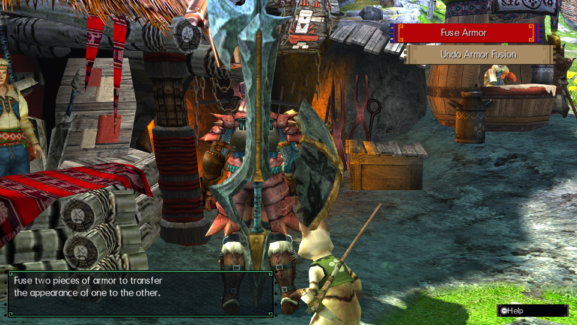
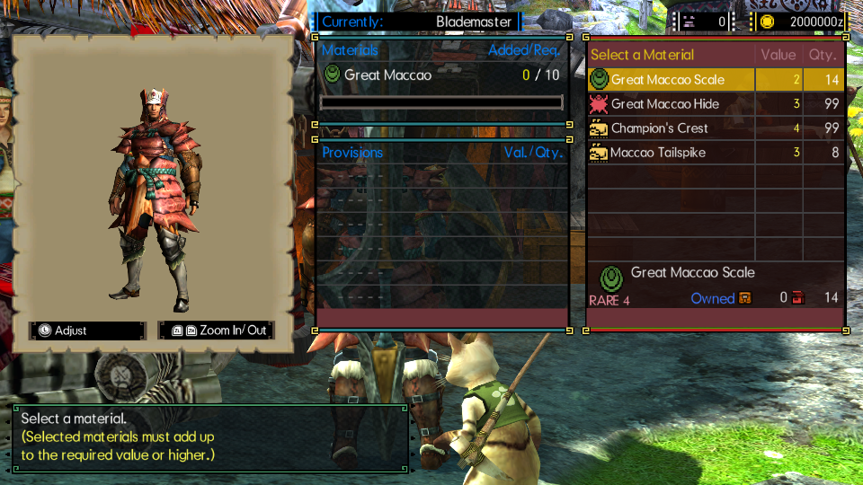
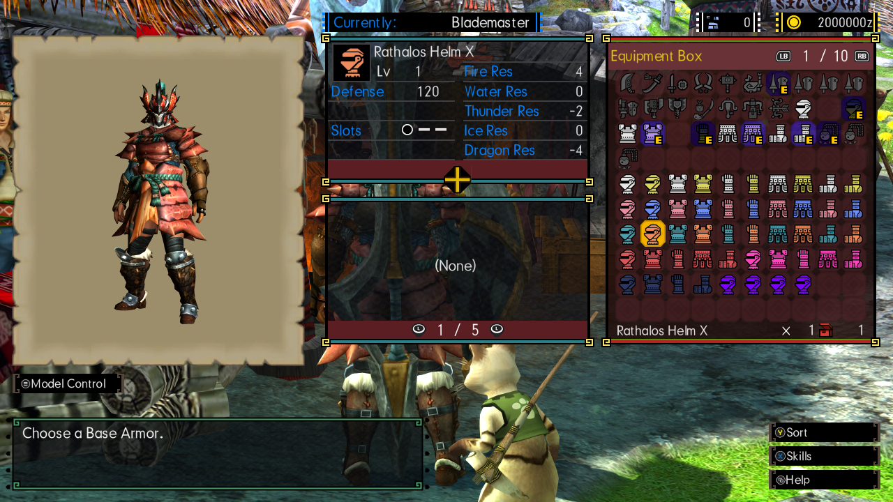
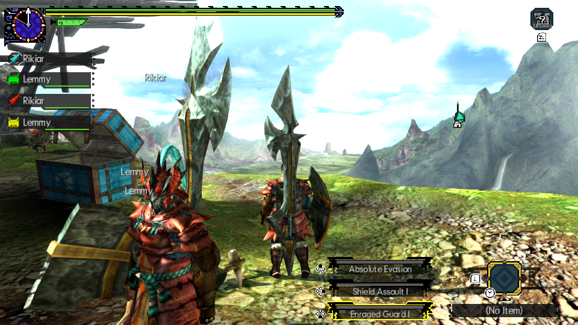

# Native Armor Fusion for MHGURecomp

A standalone Forge plugin port of the native Armor Fusion implementation from
MHGURecomp-fork commit `98ec08f`.

**[Download the latest release](https://github.com/Rikiar73574/mhgu-armor-fusion/releases/latest)**

[Hunter's Compendium companion mod](https://github.com/Rikiar73574/mhgu-compendium)

- Native smithy menus, material picker, rank/slot checks, fees and separation.
- Native decoration handling and saves, with preview lighting restored on exit.
- Embedded catalog metadata; one `armor_fusion.nro`, no external AFUS file.

Actual game captures, including HD previews and a separate unmodded observer:

| Native smithy menu | Native material picker |
| --- | --- |
|  |  |
| **HD armor preview** | **Seen by an unmodded peer** |
|  |  |

## Requirements and installation

- MHGU 1.4 game data and a compatible **stock MHGURecomp executable with Forge
  built in**. The initial compatibility target is stock commit `a272b61`.
  An external Forge core mod is not required.
- The executable must have no built-in Armor Fusion implementation. **Never
  load this plugin together with the built-in core implementation.**
- Native function signatures must match the supported game build. Unsupported
  or conflicting hooks cause initialization to stop.

Extract the release zip into its own mod directory and enable that mod in
MHGURecomp. The plugin must appear at this path relative to the mod directory:

```text
romfs/nativeNX/plugins/armor_fusion.nro
```

Restart MHGURecomp to load or unload the NRO. Keep a separate save backup before
using a new mod. The package contains the plugin, this README, license notices, and
`SHA256SUMS`; it contains no save files, extracted game tables, or game assets.

## Other plugins

Forge's plugin region is **12 MiB shared by all loaded NROs**, including each
image's BSS and alignment. The packaging tool can check other NROs against this
budget without including them in the archive:

```sh
python3 tools/package.py --other-plugin /path/to/hunters_compendium.nro
```

The companion Compendium change in `compendium/mod/src/smithy.rs` accepts a
preceding Forge entry hook on the smithy update function. Use that rebuilt
Compendium NRO when combining these plugins; the standalone patch and exact
apply/build instructions are in `compat/compendium-smithy-forge-chain.patch`
and `compat/README.md` in the source distribution. Stock entries and aligned Forge
literal jumps into Recomp's plugin region are accepted; other patched entries
remain rejected. The [Compendium release](https://github.com/Rikiar73574/mhgu-compendium/releases/latest)
already includes this change; replace the existing Compendium NRO instead of
enabling a duplicate.
Armor Fusion's caller-sensitive hooks still require untouched
stock entries. Other plugins hooking those functions are unsupported.

## Build from source

Use a local legally obtained game extraction; game data is not distributed in
this repository. Building needs Clang, LLD, Make, Python 3, and a host C compiler
for policy tests. The build generates and embeds metadata from `GAME_DIR`.

```sh
make all GAME_DIR=/path/to/game-data
make test
make test-arm ARM_PYTHON=/path/to/python-with-unicorn
python3 tools/package.py --nro build/armor_fusion.nro \
  --output dist/native-armor-fusion.zip
```

`GAME_DIR` is the directory containing `exefs/` and `romfs/`. Build products,
generated metadata and release archives stay outside version control. The zip
layout is allowlisted, and `SHA256SUMS` covers all payload files. To check
a release after extraction:

```sh
sha256sum -c SHA256SUMS
```

Each build verifies the selected dump directory and the hashes of its required
tables. Changing `GAME_DIR` or table contents regenerates embedded metadata;
unchanged inputs retain the existing artifacts. `make test` needs no game data
and runs the policy, metadata/build, and package checks. `make test-arm` also
needs the locally generated embedded catalog and a Python interpreter with
Unicorn installed; set `ARM_PYTHON` to that interpreter.

## Validation status

Linux stock `a272b61` with MHGU 1.4 passed six native paid-fusion/separation
cases across LR/HR/G and event armor, all six ordered mixed-rank rejections,
decorations, native Save/cold reload, 18 HD preview cases, cancellation/held
inputs, ordinary smithy restoration, solo parity, and an actual two-client
local shared quest with an unmodded observer. Both actual Compendium load orders
passed decorated transactions, the native wishlist hint and controller use.
The final standalone Compendium build also passed a seven-plugin installed-stack
run covering town UI, decorated payment/separation and an actual quest's passive HUD.

The tested NRO SHA-256 is
`aeaf19c048f08845f44c269842cc2ab07e4d1c678c70c4a53f76546a2aa76d11`.
Automated policy, catalog/build, ARM ABI/preflight and archive checks also pass.
The source distribution's `docs/validation.md` records the cases and methods;
`docs/port-plan.md` records the port scope. No Windows, Android, console, WAN,
four-player or every-armor coverage is claimed. Testing used copied saves and
isolated windowed clients; all owned test clients were cleanly closed. The
validation record distinguishes the two Compendium builds and the pre-existing
World Sharpness Gauge warning; gauge drawing is not claimed fixed.

## License

Mod source is MIT; see [`LICENSE`](LICENSE). No game executables or raw game
assets are distributed. Screenshots depict Monster Hunter content owned by CAPCOM.

`link/plugin.ld` is the switch32 linker template from
[Forge-RS](https://github.com/Lawrence-al/forge-rs), copyright 2026 Fexty, under
the MIT license. Its notice is preserved at `link/LICENSE.forge-rs` in the source
and as `LICENSE.forge-rs` in the runtime archive.
